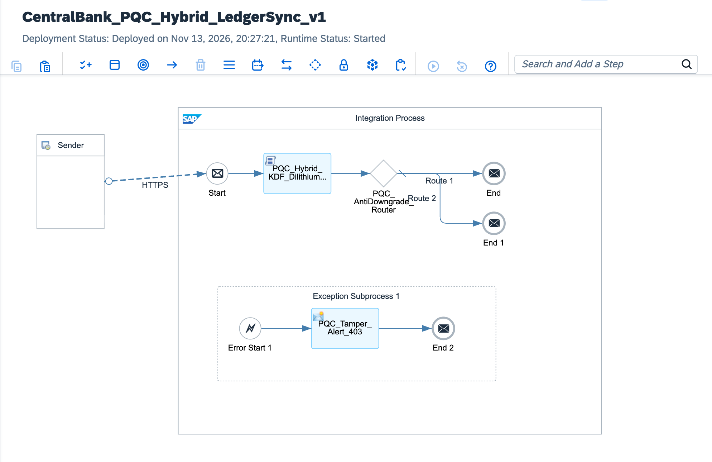

# Post-Quantum Cryptography (PQC) Financial Ledger Sync for SAP S/4HANA

[]([https://www.sap.com](https://www.sap.com))
[](#2-hybrid-post-quantum-cryptographic-pipeline)
[](#3-cryptographic-specification--anti-downgrade-matrix)
[](#4-runtime-payload--rfc-3161-tsa-audit-envelope)

An enterprise **Quantum-Safe Financial Integration Architecture** built on **SAP Integration Suite (Cloud Integration)** protecting trillion-dollar central bank clearing and settlement flows into **SAP S/4HANA Advanced Financial Closing (AFC)** against *"Harvest Now, Decrypt Later"* quantum adversaries. Because SAP CPI lacks native post-quantum primitives, this architecture leverages **BouncyCastle PQC (`bcprov-jdk18on`)** on the BTP JVM to execute a **FIPS 140-3 Hybrid Key Derivation Pipeline (`X25519 + NIST ML-KEM-768 / Kyber`)** and **NIST ML-DSA-65 (Dilithium)** digital signatures.

---

## 1. Live Implementation & Runtime Verification

### 1.1. SAP Cloud Integration PQC Hybrid Engine (`CentralBank_PQC_Hybrid_LedgerSync_v1`)
Configured with `PQC_Hybrid_KDF_Dilithium_Engine` Groovy transformation, `PQC_AntiDowngrade_Router` (`HTTP 426` rejection for classical-only handshakes), and `Exception Subprocess` integrity alerting:



### 1.2. SAP BTP Integration Runtime & Endpoint Provisioning (`Started`)
Active quantum-safe runtime endpoint deployed on SAP BTP Cloud Foundry (`eu10`) governing central bank `ISO 20022` settlement ingestion:


---

## 2. Hybrid Post-Quantum Cryptographic Pipeline

```text
  [ Central Bank Clearing Core (ISO 20022 pacs.009 / camt.054) ]
                                │
                                │ HTTPS + Header: X-PQC-Handshake-Mode
                                ▼
  ┌────────────────────────────────────────────────────────────────────────┐
  │ SAP Cloud Integration (CentralBank_PQC_Hybrid_LedgerSync_v1)           │
  │                                                                        │
  │  1. Anti-Downgrade Gate (PQC_AntiDowngrade_Router)                     │
  │     ├── Classical RSA / ECDHE Only ──► Reject HTTP 426 Upgrade Req.    │
  │     └── Hybrid ML-KEM-768 Verified ──► Proceed to Sealing Pipeline     │
  │                                                                        │
  │  2. Hybrid Key Exchange & FIPS 140-3 Combiner (BouncyCastle BTP JVM)   │
  │     ├── Classical ECDHE: X25519 Ephemeral Key Agreement (32 bytes)     │
  │     ├── Post-Quantum KEM: NIST FIPS 203 ML-KEM-768 / Kyber (1088 B)    │
  │     └── Combiner: HKDF-SHA384(X25519 || ML-KEM-768) ──► AES-256 Key    │
  │                                                                        │
  │  3. Authenticated Encryption & Quantum-Safe Non-Repudiation            │
  │     ├── Payload Cipher: AES-256-GCM (128-bit Authentication Tag)       │
  │     ├── Quantum Signature: NIST FIPS 204 ML-DSA-65 / Dilithium (3309B) │
  │     └── Audit Stamp: RFC 3161 UTC Time-Stamping Authority (TSA)        │
  └──────────────────────────────────┬─────────────────────────────────────┘
                                     │
                                     │ Quantum-Sealed Ledger Envelope
                                     ▼
  ┌────────────────────────────────────────────────────────────────────────┐
  │ SAP S/4HANA Finance Core                                               │
  │ Module: SAP S/4HANA Advanced Financial Closing (AFC) & Universal Jrnl  │
  └────────────────────────────────────────────────────────────────────────┘
```

---

## 3. Cryptographic Specification & Anti-Downgrade Matrix

| Security Layer | Algorithm / Standard | Key / Artifact Size | Enterprise Purpose |
| :--- | :--- | :---: | :--- |
| **Classical Key Agreement** | `X25519` (Curve25519 ECDHE) | `32 bytes` shared secret | Preserves existing FIPS 140-3 classical security guarantees. |
| **Post-Quantum KEM** | `NIST FIPS 203 ML-KEM-768` (Kyber) | `1,088 bytes` ciphertext | Defeats Shor's algorithm on Cryptographically Relevant Quantum Computers. |
| **Hybrid Key Combiner** | `HKDF-SHA384` (NIST SP 800-56C) | `256-bit` AES key | Cryptographically binds classical and post-quantum shared secrets. |
| **Symmetric Sealing** | `AES-256-GCM` | `128-bit` auth tag | Provides confidential, tamper-evident ledger payload encapsulation. |
| **Post-Quantum Signature** | `NIST FIPS 204 ML-DSA-65` (Dilithium) | `3,309 bytes` signature | Guarantees long-term non-repudiation across multi-decade audit horizons. |
| **Anti-Downgrade Policy** | `PQC_AntiDowngrade_Router` | `HTTP 426` enforcement | Blocks attackers attempting to force classical RSA/ECC negotiation. |

---

## 4. Runtime Payload & RFC 3161 TSA Audit Envelope

### 4.1. Inbound Central Bank Settlement (`POST /finance/pqc/v1/ledger-settlement`)
```json
{
  "settlementId": "CB-SETTLE-2026-998172",
  "centralBankBic": "DEUTDEFFXXX",
  "amount": 1250000000.00,
  "currency": "EUR"
}
```

### 4.2. Quantum-Sealed Response Envelope (`HTTP 200 OK`)
```http
HTTP/1.1 200 OK
X-PQC-Quantum-Safe-Verified: true
X-PQC-Compliance-Tier: FIPS-140-3-HYBRID-LEVEL-3
X-PQC-KEM-Algorithm: X25519+ML-KEM-768
X-PQC-DSA-Algorithm: ML-DSA-65
X-TSA-Timestamp-UTC: 2026-11-13T20:25:00.118Z

{
  "quantumSafeLedgerSync": {
    "settlementId": "CB-SETTLE-2026-998172",
    "centralBankBic": "DEUTDEFFXXX",
    "amount": 1250000000.00,
    "currency": "EUR",
    "cryptographicProof": {
      "hybridKemAlgorithm": "X25519 + NIST FIPS 203 ML-KEM-768 (Kyber)",
      "signatureAlgorithm": "NIST FIPS 204 ML-DSA-65 (Dilithium)",
      "kdfFunction": "HKDF-SHA384 (FIPS 140-3)",
      "mlKemEncapsulationBytes": 1088,
      "mlDsaSignatureBytes": 3309,
      "tsaAuthorityStamp": "2026-11-13T20:25:00.118Z"
    },
    "s4hanaTargetModule": "SAP S/4HANA Advanced Financial Closing (AFC)"
  }
}
```

---

## 5. Repository Structure

```text
.
├── README.md                                                     # Quantum-safe architecture & cryptographic proof
├── build.gradle                                                  # Gradle build with BouncyCastle 1.79 NIST PQC
├── settings.gradle                                               # Gradle root project definition
├── sap-cpi-pqc-hybrid-ledger-deployed.png                        # Live SAP CPI PQC iFlow & Anti-Downgrade proof
├── sap-cpi-pqc-runtime-monitoring.png                            # Live SAP BTP runtime monitoring proof
├── architecture/
│   └── pqc-hybrid-kdf-spec.json                                  # NIST FIPS 203/204 & FIPS 140-3 hybrid spec
├── docs/
│   └── adr/
│       └── ADR-028-post-quantum-hybrid-kdf-ledger-sync.md        # Architectural Decision Record
├── iflow/
│   ├── CentralBank_PQC_Hybrid_LedgerSync_v1.zip                  # Exported SAP Integration Suite iFlow package
│   └── extracted/                                                # Unpacked BPMN2 (.iflw) & runtime resources
└── src/
    ├── compileStub/groovy/com/sap/gateway/ip/core/customdev/util/
    │   └── Message.groovy                                        # SAP CPI Message interface contract stub
    ├── main/groovy/com/sap/cpi/pqc/
    │   └── QuantumSafeLedgerSync.groovy                          # BouncyCastle ML-KEM-768 & ML-DSA-65 engine
    └── test/groovy/com/sap/cpi/pqc/
        └── QuantumSafeLedgerSyncSpec.groovy                      # Spock Framework PQC & anti-downgrade test suite
```

---

## 6. Architectural Decision Record (ADR-028)

* **Status:** Accepted & Deployed
* **Context:** Central bank clearing records synchronized into SAP S/4HANA Advanced Financial Closing require multi-decade cryptographic confidentiality against "Harvest Now, Decrypt Later" quantum threats, while SAP CPI lacks out-of-the-box PQC adapters.
* **Decision:** Implement a BouncyCastle (`bcprov-jdk18on:1.79`) hybrid cryptographic layer in SAP CPI combining `X25519` ECDHE and `NIST FIPS 203 ML-KEM-768` via `HKDF-SHA384`, signed with `NIST FIPS 204 ML-DSA-65` and stamped with an RFC 3161 UTC TSA timestamp.
* **Consequences:** Eliminates quantum key-exchange vulnerability while preserving FIPS 140-3 classical security assurances and rejecting classical downgrade attacks with `HTTP 426`.

---

**Lead Integration Architect:** Željko Popov
